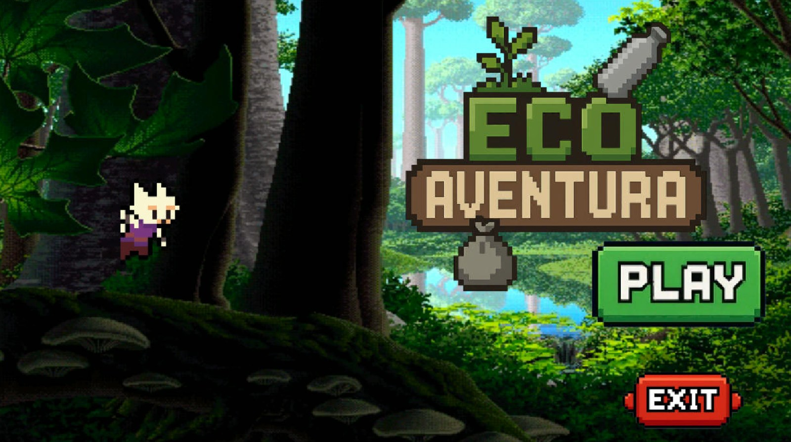
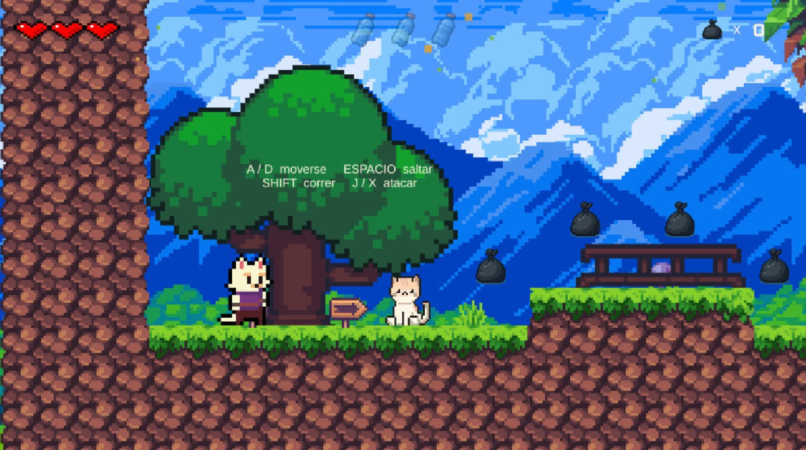
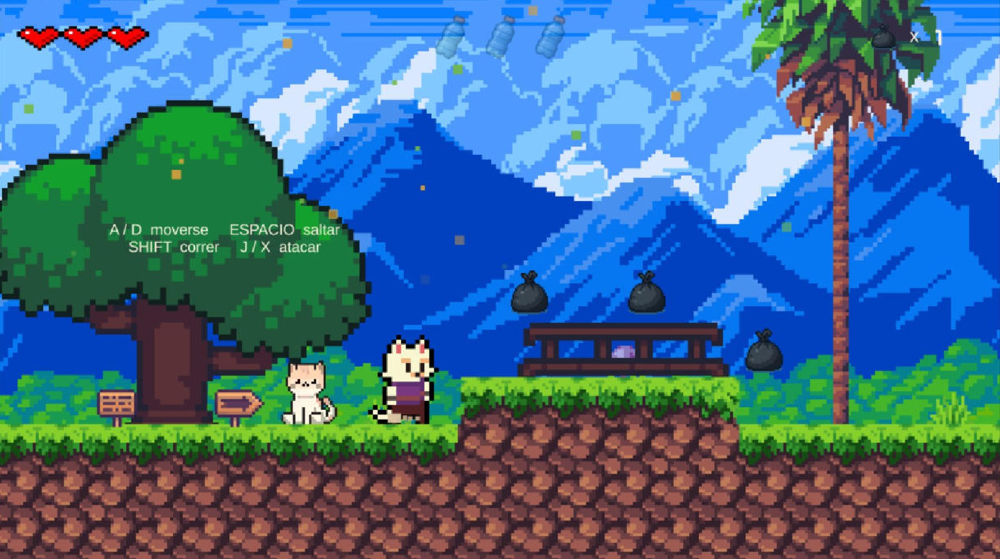
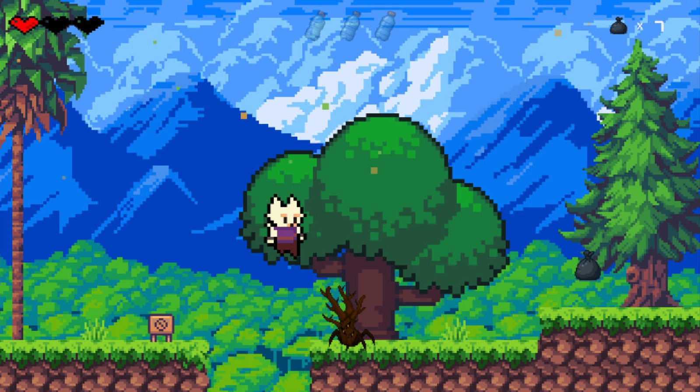

# 🌱 Eco Aventura 2.0

Videojuego de plataformas 2D en pixel art con temática ecológica, desarrollado en **Unity 2021.3** con **C#**.
El jugador recorre el bosque recogiendo basura (bolsas y botellas plásticas), esquiva y enfrenta a los enemigos y ayuda a limpiar el entorno. Es una forma divertida de promover la conciencia ambiental.

<p align="center">
  
</p>

## 🎮 Capturas

| Gameplay | Gameplay |
|---|---|
|  |  |

<p align="center">
  
  <br><em>Combate: saltando hacia un enemigo, con un foso de pinchos debajo</em>
</p>

## ✨ Novedades de la versión 2.0

- **Combate del jugador**: ataque en suelo y ataque en el aire, doble salto y agarre a paredes.
- **Nuevos enemigos con IA propia**:
  - 🐕 **Perro guardián**: vigila su zona, detecta al jugador, lo persigue sin salir de su territorio y ataca con un mordisco que se ve venir.
  - 🦅 **Águila**: patrulla el aire, avisa aleteando y se lanza en picado sobre el jugador.
  - 🐸 **Rana saltarina**: espera en su zona y salta en arco hacia el jugador, sin lanzarse al vacío.
  - 🐀 **Zarigüeya**: patrulla rápido de borde a borde y embiste al ver al jugador.
  - 🐝 Abeja, 🐌 babosa y 🌱 planta carnívora.
- **Sistema de vidas** (corazones) y **contador de residuos** recolectados.
- **Gestor de audio** con biblioteca de sonidos, ambiente dinámico por zona y música.
- **Efectos visuales** y transiciones entre escenas.
- **Cámara suave** que sigue al jugador y **fondos con parallax**.
- Menú principal, pausa, Game Over y pantalla de victoria.
- Script de **pruebas automáticas** y script de **build** desde el editor.

## 🕹️ Controles

| Acción | Tecla |
|---|---|
| Moverse | A / D |
| Saltar | Espacio |
| Correr | Shift |
| Atacar | J / X |

## 🗂️ Estructura del código

```
Assets/
├── Scripts/
│   ├── CharacterControl.cs      # Movimiento, salto, doble salto, agarre a paredes
│   ├── PlayerAttack.cs          # Ataques del jugador
│   ├── HealthSystem.cs / Death.cs
│   ├── Enemy.cs / EnemigoUtil.cs  # Base común de enemigos (daño, aturdimiento, muerte)
│   ├── PerroGuardian.cs / AguilaPicado.cs / RanaSaltarina.cs / ZarigueyaPatrulla.cs
│   ├── BeeFly.cs / SlugMove.cs
│   ├── SmoothCameraFollow.cs / FondoMovimiento.cs
│   ├── Score.cs / WinScore.cs / NextLevel.cs / CheckPoint.cs
│   ├── Audio/                   # GestorAudio, GestorAmbiente, BibliotecaSonidos
│   ├── Efectos/                 # EfectosFX, Transicion
│   └── Pruebas/                 # PruebaAutomatica
└── Editor/
    └── BuildJuego.cs            # Build del juego desde el menú del editor
```

> Este repositorio contiene el **código fuente** del juego. Los sprites, sonidos y escenas no se incluyen porque provienen de paquetes de terceros con sus propias licencias.

## 🛠️ Tecnologías

Unity 2021.3 · C# · Animator · Tilemaps · Physics 2D · Cinemachine · TextMesh Pro · UI de Unity

## 🙏 Créditos

- Basado en el proyecto open source [**The Lost Forest**](https://github.com/elifyener/TheLostForest) de Elif Yener (licencia MIT), ampliado y rediseñado como Eco Aventura.
- Gráficos: Sunny Land Forest, Free Pixel Art Hills y otros paquetes de pixel art.
- Sonidos: efectos y ambientes con licencia CC0 de OpenGameArt (ver [docs/CREDITOS_SONIDOS.txt](docs/CREDITOS_SONIDOS.txt)).

## 👤 Autor

**Hector Enrique Tinoco Rios**, estudiante de Ingeniería de Sistemas, Universidad Autónoma del Perú
[LinkedIn](https://www.linkedin.com/in/hector-enrique-tinoco-rios-5709183a4/)

## 📄 Licencia

MIT. Ver [LICENSE](LICENSE).
